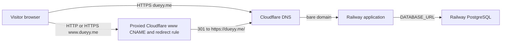
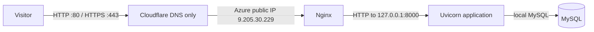
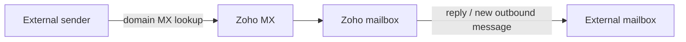
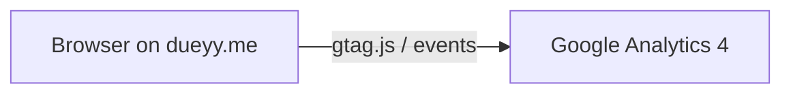

# Career Platform

## Project overview

This FastAPI site presents a career profile and resume, with project cards read
from a database. The profile remains visible when project data cannot be read.
The live site is [https://dueyy.me](https://dueyy.me); its privacy page is
[https://dueyy.me/privacy](https://dueyy.me/privacy). The application includes
profile, summary, experience, education, skills, certifications, leadership,
projects, and contact sections.

## Current and historical architecture

### A. Current Railway web path



The bare domain returned HTTP 200 to GET during the October 22, 2026 final
check. The Railway `Procfile` binds Uvicorn to `0.0.0.0:$PORT` and enables
forwarded proxy headers. Exact Railway-side TLS termination and provider
configuration are not established by repository evidence.

### B. Historical Azure deployment



The Azure evidence documents Nginx on public ports 80/443, Uvicorn on
`127.0.0.1:8000`, and local MySQL. This is historical architecture, not the
current application path.

### C. Email path



Email receipt and outbound delivery were tested. The exact MX records and a
before-MX delivery result are not recorded.

### D. Analytics path



The page includes the GA4 tag. Exercise 06 records `page_view` and outbound
click events. Outbound `link_domain`, `link_url`, and `outbound=true` help show
whether visitors use career-relevant links such as LinkedIn and GitHub.

## Application and database behavior

The application uses SQLAlchemy and `DATABASE_URL`. With a configured,
reachable database, a successful query returns HTTP 200. An empty project table
returns HTTP 200 with the deliberate “No projects listed yet.” state. A
project-query failure leaves the bundled profile visible, shows the exact
message **“Projects temporarily unavailable”**, and returns HTTP 503. Tests
also simulate a later successful request returning the project without an
application restart. See `tests/test_home.py`.

## Setup and update workflow

### Codespaces or local development

Install dependencies and run the test suite:

```bash
python -m venv .venv
source .venv/bin/activate
python -m pip install -r requirements.txt
pytest -q
```

For local MySQL in Codespaces, the repository's prior setup uses:

```bash
sudo apt-get update
sudo apt-get install -y mysql-server
sudo service mysql start
sudo mysql
```

In the MySQL shell, create the database and local-only account (replace the
example password):

```sql
CREATE DATABASE resume;
CREATE USER 'resume_app'@'127.0.0.1' IDENTIFIED BY 'replace-this-password';
GRANT ALL PRIVILEGES ON resume.* TO 'resume_app'@'127.0.0.1';
FLUSH PRIVILEGES;
EXIT;
```

Configure `DATABASE_URL` in the current shell with the local MySQL/PyMySQL
connection string. Keep credentials and environment values outside Git. The
local seed initializer is `python scripts/init_db.py`; it imports
`data/projects.json`. Do not use that seed workflow to replace current
production data. To run the app locally:

```bash
uvicorn app.main:app --host 0.0.0.0 --port 8000
```

Codespaces can forward port 8000.

### GitHub and Railway

Review and test changes locally, then push the intended revision to GitHub
`main`. The project deployment workflow is Railway deployment from `main`;
the exact service trigger settings are provider configuration and are not
stored in this repository. Do not put Railway secrets in Git. The Railway
`Procfile` supplies the web process and `$PORT` binding.

## Railway/PostgreSQL migration

No contemporaneous Railway migration plan was committed. The
[migration record](docs/evidence/railway-migration-record.md) is retrospective,
not the original cutover plan. The
[post-cutover data verification](docs/evidence/railway-data-verification.md)
records an October 21, 2026 check with source count = target count = 1 and all
fields matching exactly. Current production database data differs from the
unchanged placeholder in `data/projects.json`; restoring the seed alone would
not reproduce the production row.

## Rollback

- **Application:** Select a prior known-good Git revision, verify it is
  compatible with the current database, then redeploy it through Railway or
  revert the application changes and redeploy. Git history identifies the
  Railway compatibility commit, but does not prove a specific deployed
  revision is known-good. No rollback is claimed as tested.
- **DNS:** Point traffic back to Azure only after confirming the Azure
  application, networking, and HTTPS endpoint are available and healthy.
- **Database:** Before routing traffic to Azure or restoring older data,
  identify and reconcile any post-cutover Railway writes. There is no verified
  automatic rollback for divergent database contents.

## Azure and Railway responsibilities

| Responsibility | Azure (historical evidence) | Railway (current evidence / limits) |
|---|---|---|
| OS | Ubuntu VM | Provider-managed; exact OS unverified |
| Runtime | Uvicorn managed by systemd | Uvicorn command in `Procfile`; platform process management external |
| Web entry point | Nginx, ports 80/443, proxy to loopback port 8000 | Uvicorn binds `0.0.0.0:$PORT`; forwarded proxy headers enabled |
| TLS | Let's Encrypt certificate documented on Azure Nginx | Live certificate facts below; exact termination/provider config unverified |
| Application code | Git-based; exact production revision unverified | Git-based; exact production revision unverified |
| Configuration/secrets | External to Git | External to Git; values and full service settings unverified |
| Database software | MySQL | PostgreSQL |
| Database data | Azure source row recorded in verification evidence | Railway target row recorded and field-matched |
| DNS | Historical Cloudflare DNS-only path to Azure | `www` Cloudflare proxy/redirect is evidenced; full current DNS configuration is not in Git |

## Domain and HTTPS

The bare `dueyy.me` reached the Railway application in the October 22, 2026
check. The supplied October 21 Cloudflare evidence shows `www.dueyy.me` as a
proxied CNAME to `dueyy.me` and the enabled **“Redirect www to root”** rule.
The October 22 HTTP checks returned 301 for both `http://www.dueyy.me` and
`https://www.dueyy.me`, with `Location: https://dueyy.me/`. See the
[final domain check](docs/evidence/project1-domain-final-check.md) and
[Cloudflare redirect screenshot](docs/evidence/project1-www-redirect.png).

The live certificate observed for `dueyy.me` had subject `CN=dueyy.me`, issuer
`C=US, O=Let's Encrypt, CN=YE2`, validity from October 20, 2026 07:50:12 GMT
through January 18, 2027 07:50:11 GMT, and SAN `DNS:dueyy.me`. These are
certificate facts only. Renewal configuration or behavior was not established
by the live inspection commands and requires provider/configuration evidence.

## Zoho email

Exercise 06 records receipt of an external test message at the `dueyy.me`
mailbox, a reply received in Outlook, and a new outbound message received in
Outlook. Saved message-details evidence shows SPF, DKIM, and DMARC pass; the
header analysis also records ARC pass and the displayed `dueyy.me` domains.
The before-MX delivery result is **not contemporaneously recorded; unverified**.
See [Exercise 06](docs/evidence/ex06.md) and the
[Zoho header analysis](docs/evidence/zoho-header-check.md).

## Google Analytics

Exercise 06 records GA4 Realtime `page_view` and `click` events. Outbound-link
evidence includes `link_domain` for LinkedIn and GitHub, `link_url`, and
`outbound=true`. These signals help assess whether visitors follow professional
profile links. The
[Exercise 06 evidence](docs/evidence/ex06.md) links the event and outbound
screenshots. The site also provides a [privacy page](https://dueyy.me/privacy).

## Decisions

- **Railway/PostgreSQL or continuing to self-manage Azure:** The project had a
  documented Azure VM deployment using Nginx, systemd, and local MySQL; its
  operations required managing those VM components. The repository later added
  PostgreSQL support and a Railway process definition, and post-cutover
  evidence verifies the Railway row. Continuing Azure was the alternative.
  Exact comparative cost or performance measurements are not recorded.
- **Zoho managed email or self-hosting:** The project used a Zoho mailbox for
  `dueyy.me` and recorded successful receive, reply, and outbound checks plus
  authentication passes. Self-hosting mail was an alternative, but no
  comparison or self-hosted implementation is documented; no cost/security
  superiority is claimed.

## Investigated failures

- **Azure VM deployment — [Exercise 03](docs/evidence/ex03.md):** Symptom:
  Azure returned `RequestDisallowedByAzure` and no public IP was assigned.
  Checks/diagnosis: West US 2, West Central US, and Chile Central attempts were
  blocked by subscription regional policy. Repair: none is recorded; VM setup
  was not reached. Repeated verification: no successful VM deployment or
  public-site verification is recorded for this attempt.
- **DNS/TLS — [Exercise 05](docs/evidence/ex05.md):** Symptom: the normal
  resolver returned old Namecheap/GitHub Pages results and the browser showed
  a privacy warning, while public resolvers showed Cloudflare and the Azure
  IP. Diagnosis: a resolver/cache/path discrepancy was supported, but its
  exact cause was uncertain. Repair: adjust the client-side DNS path, disable
  the interfering network/VPN resolver path, configure Cloudflare DNS, and
  flush local cache. Repeated verification: DNS returned Cloudflare/Azure,
  HTTPS loaded without the warning, and recorded HTTP checks returned the
  expected redirects and 200 responses.

## Reflection

I better understand how DNS, TLS, application deployment, and database state
interact—and which parts belong to the application versus the hosting, DNS, and
email providers. Next time I would save migration and cutover evidence
contemporaneously instead of reconstructing it afterward.

## Costs, credits, expiry, and cleanup

- Railway Trial balance reported as observed October 21, 2026: **22 days or
  $4.92 remaining**. Treat trial limits and expiration according to course
  guidance; the complete provider terms are not recorded here.
- Keep the Azure VM running until instructor cleanup directions are received.
- Azure dollar cost is **not recorded** in the available repository evidence.
- After instructor approval, preserve required evidence, confirm database
  backup/reconciliation needs, and follow the instructor's cleanup directions
  for cloud resources.

## Remaining limitations

- No contemporaneous Railway migration plan was committed; the migration record
  is retrospective.
- The before-MX email result is unverified and not contemporaneously recorded.
- A fresh GET to `https://dueyy.me` returned HTTP 200 on October 22, 2026; no
  platform outage was observed at that check time. This is not a guarantee of
  ongoing availability.
- The original Railway cutover time, sequence, and first production revision
  are unverified. The currently deployed revision and a production-known-good
  rollback revision are also not established.
- Current Railway TLS termination, full DNS/provider settings, and later
  database writes are not established by the repository evidence. Certificate
  renewal behavior is not proven by the final live certificate inspection.

## Evidence index

- [Original database-driven application spec](docs/superpowers/specs/2026-10-01-database-driven-resume-design.md)
- [Application implementation plan](docs/superpowers/plans/2026-10-01-database-driven-resume.md)
- [Azure VM migration plan](docs/superpowers/plans/2026-09-24-azure-vm-migration.md)
- [Azure VM operation plan](docs/superpowers/plans/2026-10-01-operate-the-vm.md)
- [Exercise 03 Azure evidence](docs/evidence/ex03.md)
- [Exercise 05 DNS/TLS investigation](docs/evidence/ex05.md)
- [HTTPS/security explanation](docs/how-this-site-is-secured.md)
- [Retrospective Railway migration record](docs/evidence/railway-migration-record.md)
- [Post-cutover data verification](docs/evidence/railway-data-verification.md)
- [Final domain/HTTPS check](docs/evidence/project1-domain-final-check.md)
- [Cloudflare `www` redirect screenshot](docs/evidence/project1-www-redirect.png)
- [Exercise 06 email and GA4 results](docs/evidence/ex06.md)
- [Zoho header analysis](docs/evidence/zoho-header-check.md)
