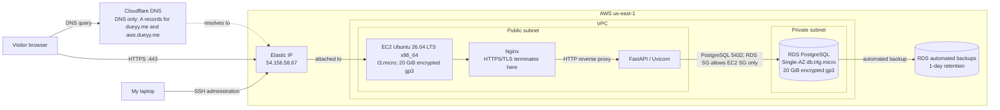
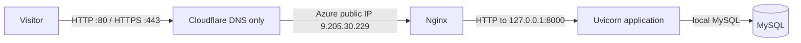
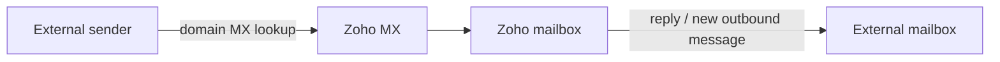
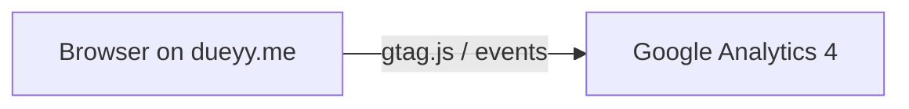

# Career Platform

## Project overview

This FastAPI site presents a career profile and resume, with project cards read
from a database. The profile remains visible when project data cannot be read.
The live site is [https://dueyy.me](https://dueyy.me); its privacy page is
[https://dueyy.me/privacy](https://dueyy.me/privacy). The application includes
profile, summary, experience, education, skills, certifications, leadership,
projects, and contact sections.

## Current and historical architecture

### AWS production and staging architecture



On November 10, 2026, production DNS moved to the AWS Elastic IP after
`aws.dueyy.me` passed staging verification. Railway stayed live until staging
passed and remains available as rollback during final verification. The AWS
Free Plan's RDS automated-backup retention limit was one day: AWS rejected the
requested seven days, and no paid upgrade was used. The independently verified
dump is also retained outside AWS. See [Exercise 07](docs/evidence/ex07.md).

### B. Historical Azure deployment



The Azure evidence documents Nginx on public ports 80/443, Uvicorn on
`127.0.0.1:8000`, and local MySQL. This is historical architecture, not the
current application path.

### C. Email path



Email receipt and outbound delivery were tested. The exact MX records and a
before-MX delivery result are not recorded.

### D. Analytics path



The page includes the GA4 tag. Exercise 06 records `page_view` and outbound
click events. Outbound `link_domain`, `link_url`, and `outbound=true` help show
whether visitors use career-relevant links such as LinkedIn and GitHub.

## Application and database behavior

The application uses SQLAlchemy and `DATABASE_URL`. With a configured,
reachable database, a successful query returns HTTP 200. An empty project table
returns HTTP 200 with the deliberate “No projects listed yet.” state. A
project-query failure leaves the bundled profile visible, shows the exact
message **“Projects temporarily unavailable”**, and returns HTTP 503. Tests
also simulate a later successful request returning the project without an
application restart. See `tests/test_home.py`.

## Setup and update workflow

### Codespaces or local development

Install dependencies and run the test suite:

```bash
python -m venv .venv
source .venv/bin/activate
python -m pip install -r requirements.txt
pytest -q
```

For local MySQL in Codespaces, the repository's prior setup uses:

```bash
sudo apt-get update
sudo apt-get install -y mysql-server
sudo service mysql start
sudo mysql
```

In the MySQL shell, create the database and local-only account (replace the
example password):

```sql
CREATE DATABASE resume;
CREATE USER 'resume_app'@'127.0.0.1' IDENTIFIED BY 'replace-this-password';
GRANT ALL PRIVILEGES ON resume.* TO 'resume_app'@'127.0.0.1';
FLUSH PRIVILEGES;
EXIT;
```

Configure `DATABASE_URL` in the current shell with the local MySQL/PyMySQL
connection string. Keep credentials and environment values outside Git. The
local seed initializer is `python scripts/init_db.py`; it imports
`data/projects.json`. Do not use that seed workflow to replace current
production data. To run the app locally:

```bash
uvicorn app.main:app --host 0.0.0.0 --port 8000
```

Codespaces can forward port 8000.

### GitHub and deployment

AWS serves production as of November 10, 2026. Railway was kept live through
staging verification and remains available for rollback during final
verification. The exact AWS deployment automation is not recorded here.
Keep deployment secrets outside Git.

## Railway/PostgreSQL migration history

The [Railway migration record](docs/evidence/railway-migration-record.md)
documents the earlier migration to Railway retrospectively, not its original
cutover plan. [Exercise 07](docs/evidence/ex07.md) records the later AWS
restore and production cutover. The
[post-cutover data verification](docs/evidence/railway-data-verification.md)
records an October 21, 2026 check with source count = target count = 1 and all
fields matching exactly. The AWS restore also contained the verified project
row. Production data differs from the unchanged placeholder in
`data/projects.json`; restoring the seed alone would not reproduce it.

## Rollback

- **Application and DNS:** Railway remains available as a rollback target
  during final AWS verification. Before routing traffic back, verify the
  Railway application, database state, and HTTPS endpoint, then restore the
  appropriate Cloudflare DNS record.
- **Database:** Before serving from an older database or restoring data,
  identify and reconcile writes made after cutover. Do not overwrite the
  verified AWS database with an older copy.

## AWS, Railway, and Azure responsibilities

| Responsibility | AWS (current) | Railway (rollback) | Azure (historical) |
|---|---|---|---|
| OS | Ubuntu 26.04 LTS x86_64 on EC2 | Provider-managed; exact OS unverified | Ubuntu VM |
| Runtime | Nginx and FastAPI/Uvicorn on EC2 | Uvicorn command in `Procfile`; provider process management | Uvicorn managed by systemd |
| Web entry point | Elastic IP to Nginx; HTTPS terminates at Nginx | Not the current DNS target | Nginx on ports 80/443 |
| Database | Private Single-AZ RDS PostgreSQL | PostgreSQL retained for rollback | MySQL |
| Database data | AWS RDS restore verified with one project row | No project data changed after the verified backup; later state must be checked before rollback | Azure source row in historical evidence |
| DNS | DNS-only A records for `dueyy.me` and `aws.dueyy.me` to the Elastic IP | Not the current DNS target | Historical Cloudflare path to Azure |

## Domain and HTTPS

At the November 10, 2026 cutover, the Cloudflare root record changed from the
Railway CNAME to a DNS-only A record for `54.156.58.67`; `aws.dueyy.me` also
resolves to that address. Nginx terminates HTTPS, and the Let's Encrypt
certificate covers both names. Staging and production HTTPS checks passed;
see [Exercise 07](docs/evidence/ex07.md).

The October 21-22 Cloudflare `www` redirect and certificate checks predate the
AWS cutover; they are historical evidence, not the current production path.
See the [final domain check](docs/evidence/project1-domain-final-check.md) and
[Cloudflare redirect screenshot](docs/evidence/project1-www-redirect.png).
Certificate renewal behavior is not established by the verification recorded
here.

## Zoho email

Exercise 06 records receipt of an external test message at the `dueyy.me`
mailbox, a reply received in Outlook, and a new outbound message received in
Outlook. Saved message-details evidence shows SPF, DKIM, and DMARC pass; the
header analysis also records ARC pass and the displayed `dueyy.me` domains.
The before-MX delivery result is **not contemporaneously recorded; unverified**.
See [Exercise 06](docs/evidence/ex06.md) and the
[Zoho header analysis](docs/evidence/zoho-header-check.md).

## Google Analytics

Exercise 06 records GA4 Realtime `page_view` and `click` events. Outbound-link
evidence includes `link_domain` for LinkedIn and GitHub, `link_url`, and
`outbound=true`. These signals help assess whether visitors follow professional
profile links. The
[Exercise 06 evidence](docs/evidence/ex06.md) links the event and outbound
screenshots. The site also provides a [privacy page](https://dueyy.me/privacy).

## Decisions

- **AWS-managed database or PostgreSQL on EC2:** I chose one EC2 app instance
  and a separate private, Single-AZ RDS PostgreSQL database, accepting
  additional cost and Single-AZ availability risk for AWS-managed database
  operations and app/database separation. The Free Plan limited automated
  backup retention to one day rather than the requested seven days.
- **Railway/PostgreSQL or continuing to self-manage Azure:** The project had a
  documented Azure VM deployment using Nginx, systemd, and local MySQL; its
  operations required managing those VM components. The repository later added
  PostgreSQL support and a Railway process definition, and post-cutover
  evidence verifies the Railway row. Continuing Azure was the alternative.
  Exact comparative cost or performance measurements are not recorded.
- **Zoho managed email or self-hosting:** The project used a Zoho mailbox for
  `dueyy.me` and recorded successful receive, reply, and outbound checks plus
  authentication passes. Self-hosting mail was an alternative, but no
  comparison or self-hosted implementation is documented; no cost/security
  superiority is claimed.

## Investigated failures

- **Azure VM deployment — [Exercise 03](docs/evidence/ex03.md):** Symptom:
  Azure returned `RequestDisallowedByAzure` and no public IP was assigned.
  Checks/diagnosis: West US 2, West Central US, and Chile Central attempts were
  blocked by subscription regional policy. Repair: none is recorded; VM setup
  was not reached. Repeated verification: no successful VM deployment or
  public-site verification is recorded for this attempt.
- **DNS/TLS — [Exercise 05](docs/evidence/ex05.md):** Symptom: the normal
  resolver returned old Namecheap/GitHub Pages results and the browser showed
  a privacy warning, while public resolvers showed Cloudflare and the Azure
  IP. Diagnosis: a resolver/cache/path discrepancy was supported, but its
  exact cause was uncertain. Repair: adjust the client-side DNS path, disable
  the interfering network/VPN resolver path, configure Cloudflare DNS, and
  flush local cache. Repeated verification: DNS returned Cloudflare/Azure,
  HTTPS loaded without the warning, and recorded HTTP checks returned the
  expected redirects and 200 responses.

## Reflection

I better understand how DNS, TLS, application deployment, and database state
interact—and which parts belong to the application versus the hosting, DNS, and
email providers. Next time I would save migration and cutover evidence
contemporaneously instead of reconstructing it afterward.

## Costs, credits, expiry, and cleanup

- AWS Section 6 baseline estimate with `db.t4g.micro`: **about $26.82/month**
  ($7.59 EC2 compute, $11.68 RDS compute, and $7.55 storage/public IPv4/other
  baseline), before taxes and variable usage. The AWS Free Plan had **$100 in
  credits remaining before resources were created**. See [Exercise 07](docs/evidence/ex07.md)
  for the current billing evidence status.
- Railway Trial balance reported as observed October 21, 2026: **22 days or
  $4.92 remaining**. Treat trial limits and expiration according to course
  guidance; the complete provider terms are not recorded here.
- Azure dollar cost is **not recorded** in the available repository evidence.
- Do not delete the Railway rollback environment or change AWS resources until
  final verification and instructor cleanup directions are complete.

## Remaining limitations

- The before-MX email result is unverified and not contemporaneously recorded.
- The AWS staging and production checks are point-in-time results, not a
  guarantee of ongoing availability.
- Railway remains available for rollback during final verification; any
  database changes after cutover must be reconciled before switching back.
- The exact AWS deployed Git revision and certificate renewal behavior are
  not recorded here.

## Evidence index

- [Original database-driven application spec](docs/superpowers/specs/2026-10-01-database-driven-resume-design.md)
- [Application implementation plan](docs/superpowers/plans/2026-10-01-database-driven-resume.md)
- [Azure VM migration plan](docs/superpowers/plans/2026-09-24-azure-vm-migration.md)
- [Azure VM operation plan](docs/superpowers/plans/2026-10-01-operate-the-vm.md)
- [Exercise 03 Azure evidence](docs/evidence/ex03.md)
- [Exercise 05 DNS/TLS investigation](docs/evidence/ex05.md)
- [HTTPS/security explanation](docs/how-this-site-is-secured.md)
- [Retrospective Railway migration record](docs/evidence/railway-migration-record.md)
- [Post-cutover data verification](docs/evidence/railway-data-verification.md)
- [Final domain/HTTPS check](docs/evidence/project1-domain-final-check.md)
- [Cloudflare `www` redirect screenshot](docs/evidence/project1-www-redirect.png)
- [Exercise 06 email and GA4 results](docs/evidence/ex06.md)
- [Zoho header analysis](docs/evidence/zoho-header-check.md)
