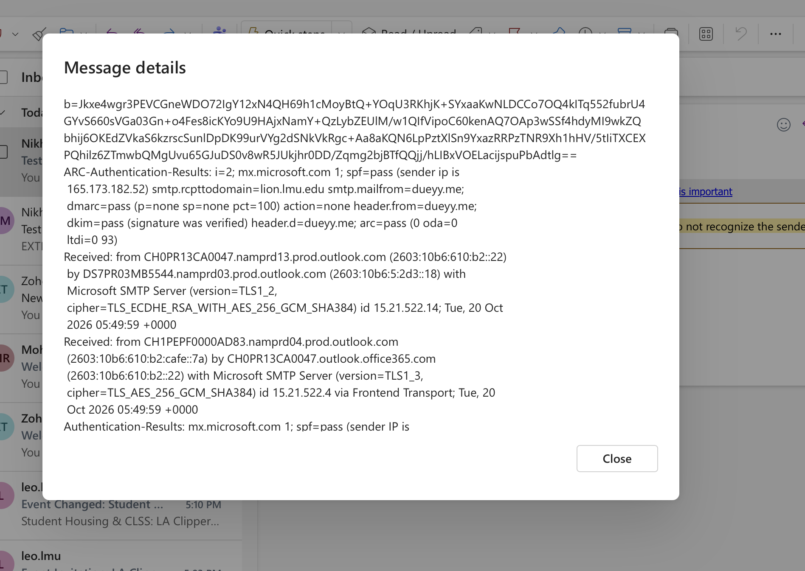
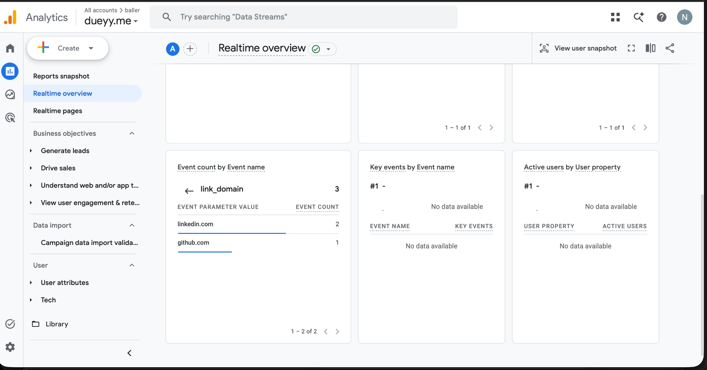
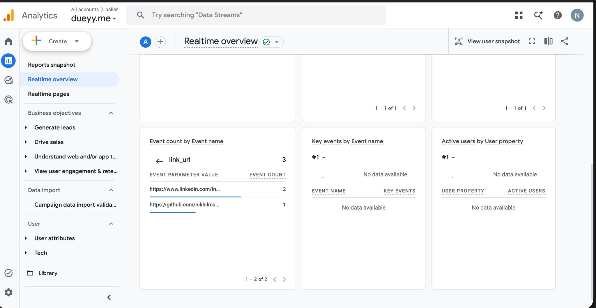
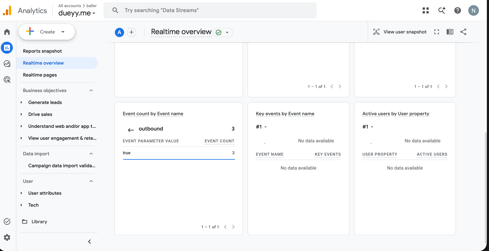

# Exercise 06 Evidence

## Domain email
Mailbox:
nikhil.mandyam@dueyy.me

Email tests:
- Received external test email successfully at about 10:34 PM
- Replied from the dueyy.me mailbox successfully; reply arrived in Outlook at about 10:48 PM
- Sent a new outbound email from dueyy.me successfully; it arrived in Outlook at about 10:50 PM
- Before-MX delivery result: not contemporaneously recorded; unverified.

Authentication:
- SPF: pass
- DKIM: pass
- DMARC: pass

## Google Analytics 4
Live site:
https://dueyy.me

Privacy page:
https://dueyy.me/privacy

GA4 Realtime successfully recorded:
- page_view
- click

Outbound click evidence:
- link_domain included linkedin.com and github.com
- link_url showed the external LinkedIn and GitHub URLs
- outbound = true

