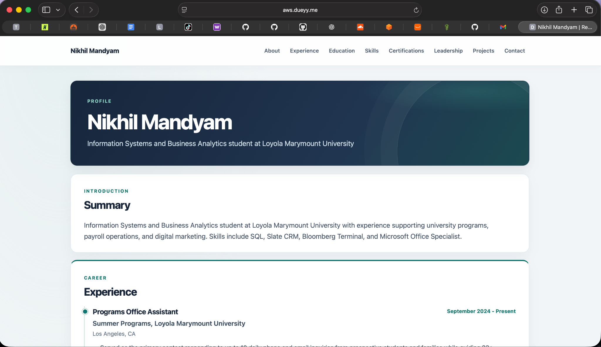
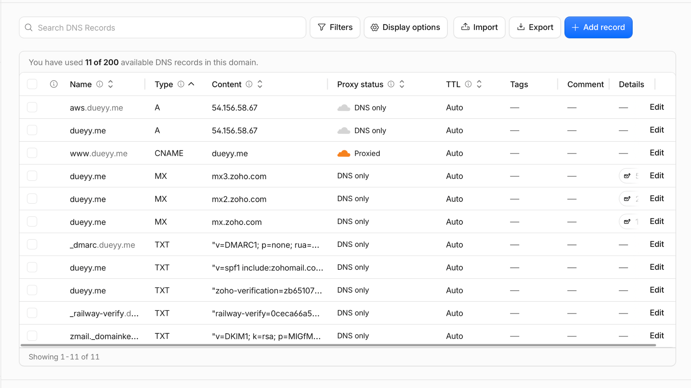
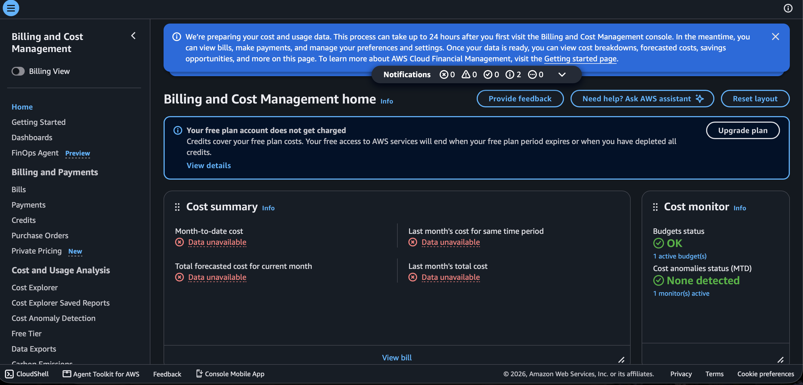

# Exercise 07 Evidence

## 1. Architecture decision

I chose EC2 with a separate private Single-AZ RDS PostgreSQL database over running PostgreSQL locally on EC2, accepting additional cost and Single-AZ availability risk in exchange for AWS-managed database operations and app/database separation; see the [README architecture diagram](../../README.md#aws-production-and-staging-architecture).

## 2. Backup record

Railway PostgreSQL 18.6 backup created **2026-11-10 05:12:51 UTC**. The restore test **passed** in **0.139 seconds**: one projects row was restored and a representative row matched production. The independently verified dump was kept outside Git and copied to a Mac; no Railway project data changed after the backup. The AWS RDS restore also passed and contained the same one project row. Accepted **RPO: 24 hours; RTO: 2 hours**.

The professor requested seven-day RDS automated backup retention. It exceeded the AWS Free Plan maximum: AWS rejected seven days, so I did not upgrade or pay to bypass the restriction. RDS was created with **one-day retention**. The independent PostgreSQL dump remains outside AWS.

## 3. Test-subdomain verification

| Test | Evidence | Status |
|---|---|---|
| `aws.dueyy.me` DNS resolves to `54.156.58.67` | DNS check during migration | PASS |
| HTTP redirects to HTTPS | HTTP `301` observed | PASS |
| HTTPS request and certificate | HTTPS GET `200`; Let's Encrypt certificate | PASS |
| Browser rendering and styling | Browser staging check | PASS |
| Restored project is visible | Career Platform Website project visible on staging | PASS |

## 4. Cutover status

On **November 10, 2026**, the Cloudflare `dueyy.me` root record changed from a Railway CNAME to a DNS-only A record for `54.156.58.67`. The certificate was expanded to cover `dueyy.me` and `aws.dueyy.me`; production HTTPS and project data were verified after cutover.

## 5. Cost

Section 6 baseline estimate using `db.t4g.micro`: **approximately $26.82/month** — EC2 compute **$7.59**, RDS compute **$11.68**, and storage/public IPv4/other baseline **$7.55**. The AWS Free Plan had **$100 in credits remaining before resources were created**. The current billing screenshot shows cost data is still unavailable, so the current billed amount is **NOT VERIFIED**.

