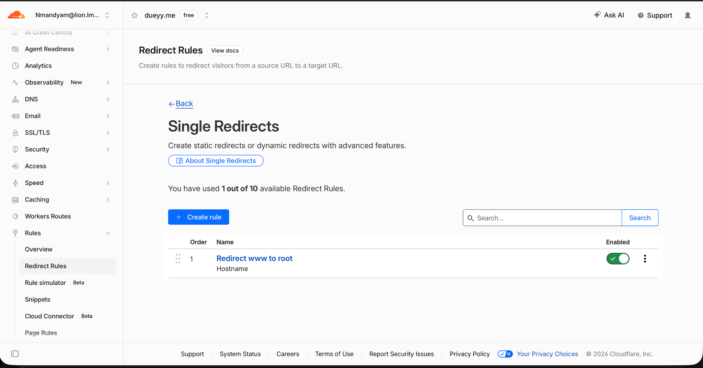

# Project 1 Domain and HTTPS Final Check

## Live checks

Commands were run from Codespaces on **October 22, 2026 (UTC)**.

| Request | Observed response | `Location` |
|---|---:|---|
| `curl -I http://www.dueyy.me` | `301 Moved Permanently` | `https://dueyy.me/` |
| `curl -I https://www.dueyy.me` | `301` | `https://dueyy.me/` |
| `curl -I https://dueyy.me` | `405` (`HEAD` is not allowed by the application) | None |
| `GET https://dueyy.me` | `200` | Not applicable |

The two `www` responses direct to the root HTTPS site. The successful GET
confirms the root HTTPS site responds successfully; the HEAD 405 is not a TLS
failure.

## Live TLS certificate for `dueyy.me`

The certificate returned by the TLS endpoint showed:

- Subject: `CN=dueyy.me`
- Issuer: `C=US, O=Let's Encrypt, CN=YE2`
- Valid from: `Oct 20 07:50:12 2026 GMT`
- Valid until: `Jan 18 07:50:11 2027 GMT`
- Subject Alternative Name: `DNS:dueyy.me`

These are the certificate facts observed for `dueyy.me`; the SAN output does not
list `www.dueyy.me`.

## Cloudflare redirect evidence

The Cloudflare dashboard screenshot was observed on **October 21, 2026** and
shows the enabled Cloudflare Redirect Rule **“Redirect www to root.”** The
`www` redirect is implemented by Cloudflare.

## Renewal

These HTTP and certificate inspection commands do not establish certificate
renewal configuration or behavior. Renewal needs separate documentation or
verification from the relevant provider configuration.
